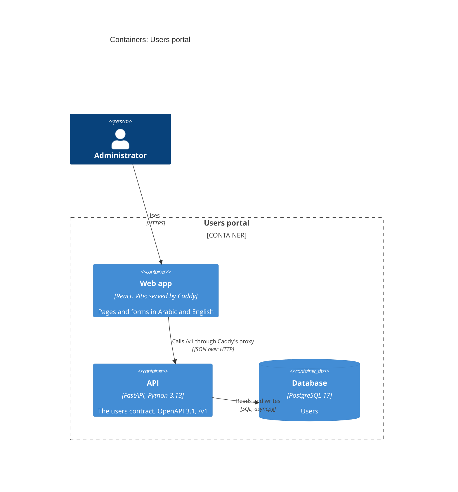

# Containers: Users portal

The portal's deployable parts and how they talk (C4 level 2). Each container is one image built from
its repository's Dockerfile; locally they run in Docker Compose (decisions 70-72).

| Container | Image | Reaches |
|---|---|---|
| Web app | `caddy:2-alpine` with the built app | the API, through `/v1` |
| API | `python:3.13-slim-bookworm` with the app | the database |
| Database | `postgres:17-alpine` | nothing |
