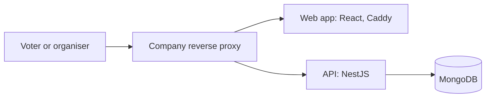

# Architecture: Team lunch poll

Two containers behind the company's reverse proxy (D-008): the web app (React, served by Caddy) and the API (NestJS), with one MongoDB database (D-007). Polls close at their closing time: the API treats a poll as closed when the closing time has passed, so nothing runs on a timer. A daily job deletes polls 30 days after closing (D-006), run by the API's scheduler.

